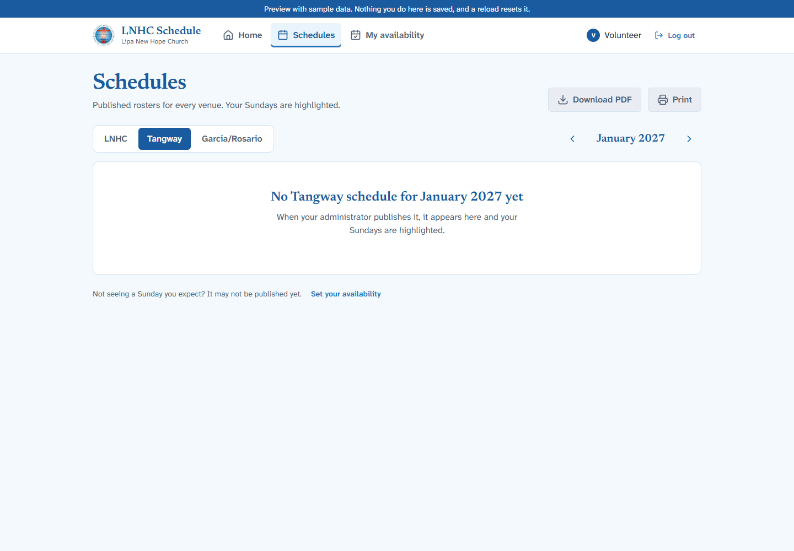
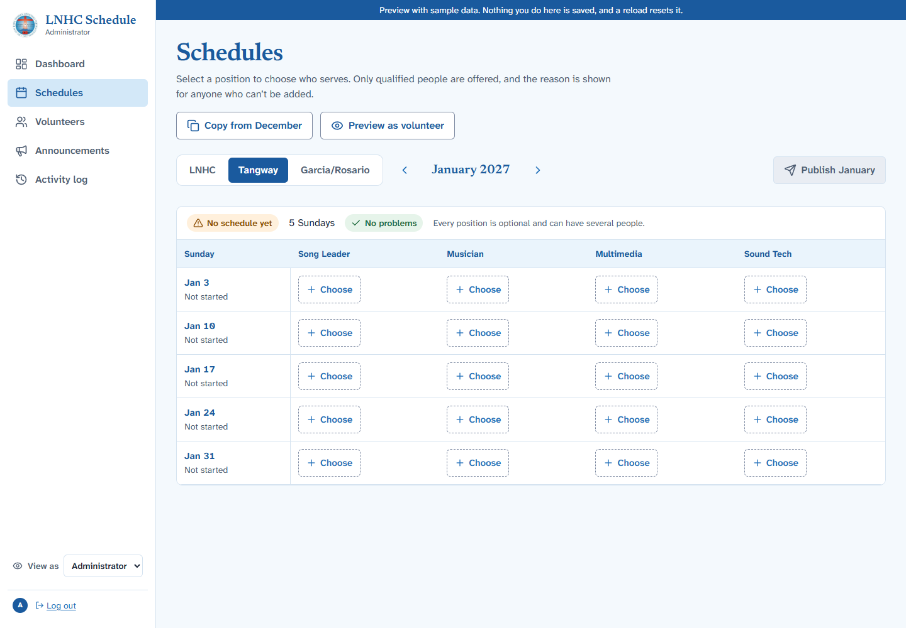
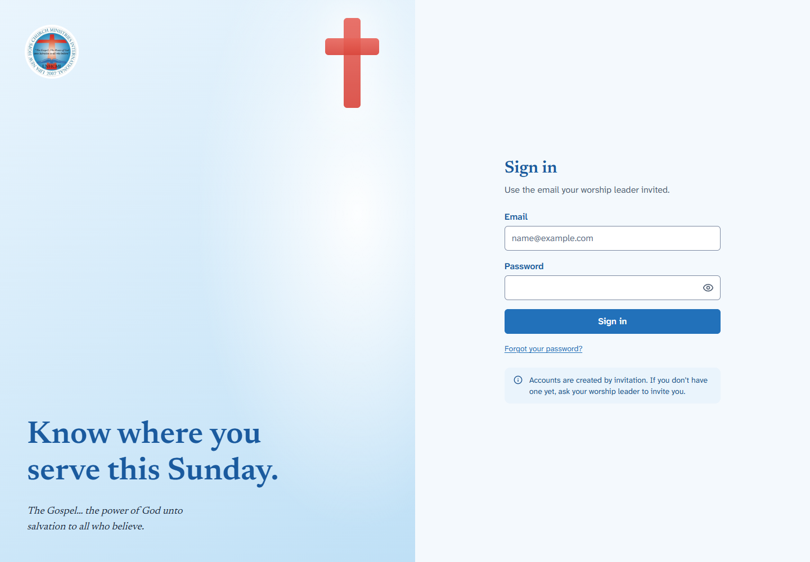
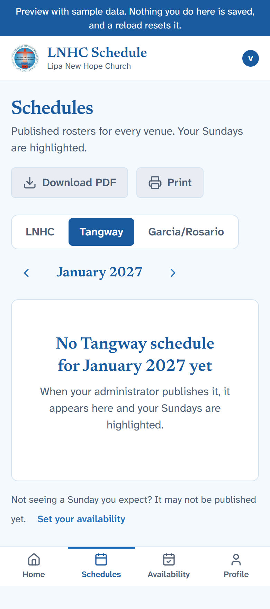

<div align="center">
  
  <h1>LNHC Schedule</h1>
  <p><strong>A simpler way to plan and follow the Lipa New Hope Church worship roster.</strong></p>
  <p>
    
    
    
    
    
  </p>
</div>

LNHC Schedule is a web application for organizing worship-team schedules across Lipa New Hope Church venues. Volunteers can check published rosters and submit date-specific availability; schedule makers can prepare, review, and publish assignments.

> **Project status:** The interface and a Supabase backend implementation are present. The app has been exercised with its local in-memory demo backend; it has not yet been connected to a hosted Supabase project or deployed. Treat production authentication, database behavior, and hosting as unverified.

## Screenshots

These screenshots were captured from the running application in demo mode. They show empty schedule states so no volunteer assignments or account details are published here.

| Volunteer schedule | Schedule editor |
| --- | --- |
|  |  |

| Sign in | Mobile schedule |
| --- | --- |
|  |  |

## What it does

### Implemented in the application

- Shows published schedules by venue and month, with the signed-in volunteer’s assignments highlighted.
- Lets volunteers submit availability for individual Sundays and view their profile.
- Provides schedule makers and administrators with schedule editing, assignment checks, publishing, and copy-from-month tools.
- Manages volunteers and qualifications, announcements, and an activity log.
- Downloads published schedules as a PDF (up to three months per file) and supports printing.
- Defines invite-based authentication flows and role checks for volunteers, schedule makers, and administrators.

The screens currently use an in-memory demo backend for local review. Supabase services, SQL migrations, row-level security policies, and an invite Edge Function are in the repository, but their behavior against a hosted project has not been verified. See the [roadmap](DEVELOPMENT_ROADMAP.md) for current project status and limitations.

### Not yet available or verified

- A hosted Supabase project and production deployment are not configured in this repository.
- The real backend, invitation delivery, and sign-in links have not been exercised end to end.
- Recurring availability and notifications when a published schedule changes are not implemented.
- Venue and position catalog management screens are not implemented.

## Technology

| Area | Technologies | Use |
| --- | --- | --- |
| Web application | React 19, TypeScript, Vite 8 | User interface, type checking, and local development/builds |
| Styling and navigation | Tailwind CSS 4, React Router 7 | Responsive styles and client-side routes |
| Backend integration | Supabase JS, Supabase Auth, PostgreSQL | Authentication and typed data access; hosted connection is pending |
| Database rules | PostgreSQL migrations and row-level security | Scheduling constraints and role-based access rules |
| Server-side function | Supabase Edge Functions | Volunteer invitation flow |
| PDF output | jsPDF and jsPDF AutoTable | Roster downloads |
| UI icons | Lucide React | Interface icons |

## Project structure

```text
.
├── public/                 Church logo and static assets
├── src/
│   ├── app/                Routes, pages, authentication context
│   ├── components/         Shared layout and UI components
│   ├── features/           Scheduling, volunteers, availability, administration
│   ├── lib/                Supabase client, roster, date, and PDF helpers
│   └── preview/            In-memory demo service implementations and seed data
├── supabase/
│   ├── migrations/         Database schema and policy migrations
│   ├── functions/          Edge Functions
│   └── tests/              Database-rule tests
├── tests/
│   ├── e2e/                Browser-based demo flows and accessibility checks
│   └── unit/               Unit tests
├── docs/                   Architecture, audit, design, and screenshots
├── .env.example            Placeholder configuration variable names
└── package.json            Scripts and dependencies
```

## Getting started

### Prerequisites

- Node.js `20.19+` or `22.12+` (required by the installed Vite version)
- npm
- Chrome or Edge only if you plan to run the end-to-end browser checks

### Run the local demo

The demo mode uses an in-memory backend and does not need Supabase credentials:

```bash
npm install
npm run demo
```

Open `http://localhost:5173`. Demo changes are not persisted and reset when the page reloads.

> **Privacy:** The current demo seed includes real church roster records. Do not publish or share a populated demo session or capture its roster data. The screenshots in this README use empty schedule states.

### Run against a Supabase project

1. Install dependencies with `npm install`.
2. Copy the example environment file:

   ```bash
   # macOS / Linux
   cp .env.example .env

   # Windows PowerShell
   Copy-Item .env.example .env
   ```

3. Set the project URL and publishable key in `.env`:

   ```env
   VITE_SUPABASE_URL=your_supabase_project_url
   VITE_SUPABASE_PUBLISHABLE_KEY=your_supabase_publishable_key
   ```

4. Configure the Supabase schema and first administrator by following [DATABASE_SCHEMA.md](DATABASE_SCHEMA.md).
5. Start the development server:

   ```bash
   npm run dev
   ```

Only use a Supabase publishable key in browser-exposed `VITE_` variables. Never put a Supabase secret/service-role key or database connection string in a `VITE_` variable. Values in `.env` must remain private and must not be committed.

## Development commands

| Command | Description |
| --- | --- |
| `npm run dev` | Start Vite against the configured Supabase backend |
| `npm run demo` | Start Vite in local demo mode |
| `npm run build` | Type-check and create a production build in `dist/` |
| `npm run build:demo` | Build the demo-mode app (for review, not production) |
| `npm run preview` | Serve the production build locally |
| `npm run typecheck` | Run the TypeScript project checks |
| `npm run lint` | Run ESLint |
| `npm run format:check` | Check formatting with Prettier |
| `npm run format` | Format files with Prettier |
| `npm run test:unit` | Run unit tests for date, roster, and PDF helpers |
| `npm run test:db` | Run database-rule tests using in-memory PostgreSQL (PGlite) |
| `npm run test:e2e` | Run browser flows and accessibility checks in Chrome or Edge |
| `npm test` | Run unit, database, and end-to-end checks |

## Deployment

Deployment is a future project phase. The roadmap names Vercel as the intended frontend host and Supabase as the backend, but neither a live deployment nor a production Supabase connection is verified. See [DEVELOPMENT_ROADMAP.md](DEVELOPMENT_ROADMAP.md) before attempting deployment.

## Contributing

Contributions are welcome. Before opening a pull request:

1. Keep changes focused and describe the user-facing or maintenance impact.
2. Do not include real volunteer details, credentials, populated demo screenshots, or private environment files.
3. Run the relevant checks from [Development commands](#development-commands).
4. Update the documentation when commands, configuration, or implemented behavior changes.

For changes to scheduling rules or access control, review [SCHEDULING_RULES.md](SCHEDULING_RULES.md), [USER_ROLES_AND_PERMISSIONS.md](USER_ROLES_AND_PERMISSIONS.md), and the Supabase migrations.

## Documentation

- [Architecture](ARCHITECTURE.md)
- [Database setup and schema](DATABASE_SCHEMA.md)
- [Scheduling rules](SCHEDULING_RULES.md)
- [Roles and permissions](USER_ROLES_AND_PERMISSIONS.md)
- [Development roadmap and known limits](DEVELOPMENT_ROADMAP.md)
- [Design system](DESIGN_SYSTEM.md)
- [Changelog](CHANGELOG.md)
- [Project foundation](PROJECT_FOUNDATION.md)

## License

No license file is currently included in this repository.

## Acknowledgments

Built for Lipa New Hope Church. The project uses open-source React, TypeScript, Vite, Tailwind CSS, Supabase, Lucide, and jsPDF tooling.
